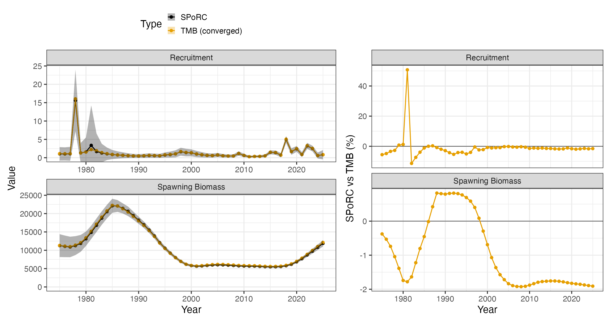
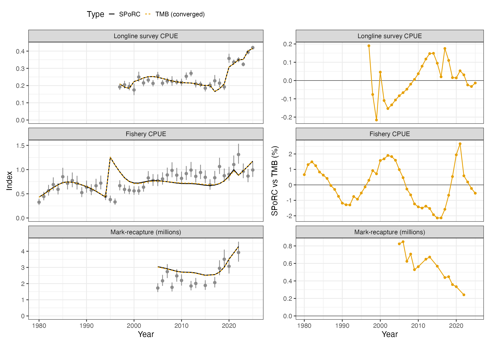
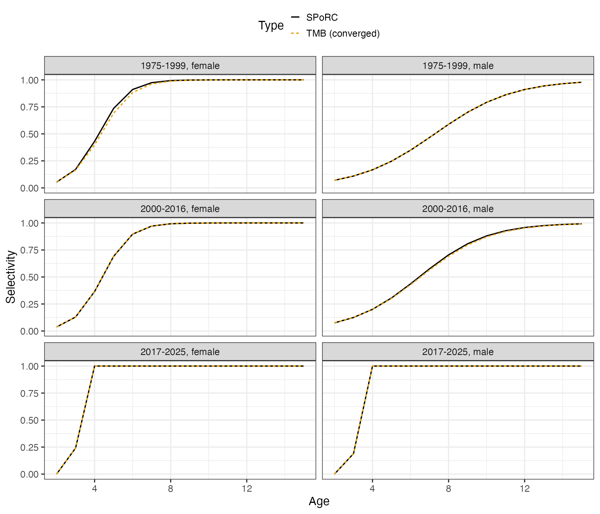
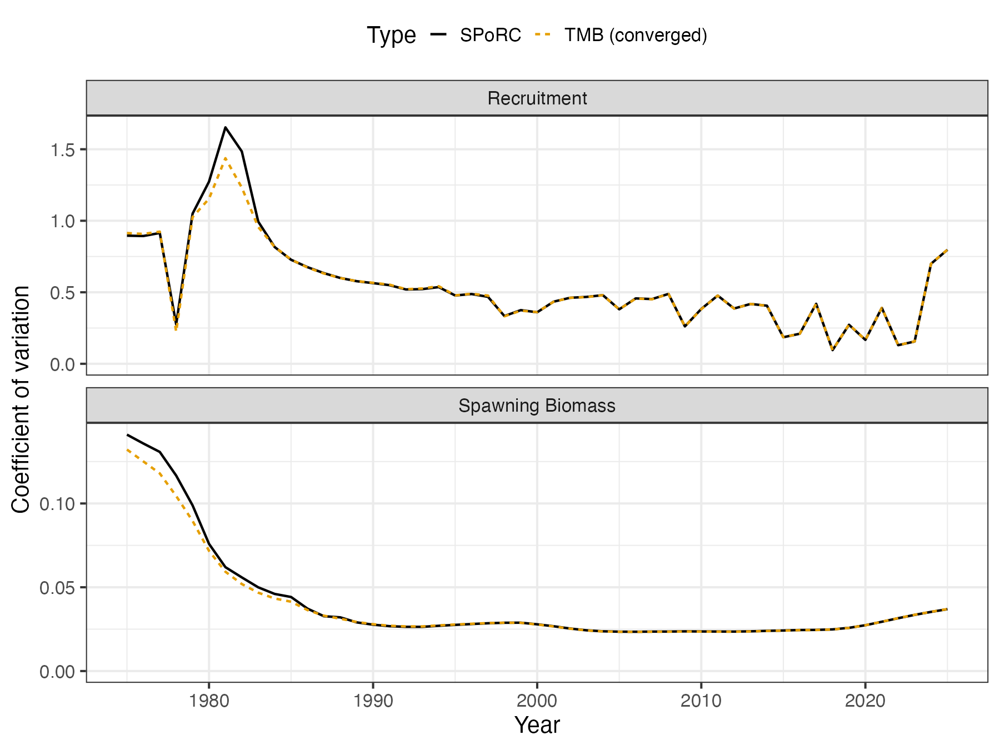

## Overview

In this vignette, we will demonstrate how the 2025 Northern Southeast Inside (NSEI) sablefish stock assessment, conducted by the Alaska Department of Fish and Game (Lambert and Ehresmann 2026), can be set up in `SPoRC` and compares model outputs from `SPoRC` to the existing TMB model (`scaa_mod_v23_Aaron2.cpp`, run `v23_3f_3s_2016_NEW_FINAL`). The NSEI sablefish stock is assessed as a panmictic single-region model from 1975 to 2025, with 2 sexes (females and males), ages 2 to 31 (with a plus group), 2 cm length bins from 41 to 99 cm, 1 fishery, and 3 indices (a longline survey CPUE, a fishery CPUE, and a mark-recapture abundance estimate).

| Data source | Years | Observations | Likelihood |
|---|---|---|---|
| Landed catch | 1975 to 2025 | 51 | Lognormal, standard deviation 0.05 |
| Longline survey CPUE (July) | 1997 to 2025 | 29 | Lognormal, numbers |
| Fishery CPUE | 1980 to 2025 | 46 | Lognormal, biomass, three catchability blocks |
| Mark-recapture abundance | 2005 to 2022 | 14 | Lognormal, numbers, catchability prior |
| Fishery age compositions | 2002 to 2025 | 24 | Multinomial, sexes combined |
| Fishery length compositions | 2002 to 2025 | 24 per sex | Multinomial, by sex |
| Survey age compositions | 1997 to 2025 | 29 | Multinomial, sexes combined |
| Survey length compositions | 1997 to 2025 | 29 per sex | Multinomial, by sex |

There are a couple of features in this model that are worth noting before we set it up. First, the fishery retains fish following a fixed probability of retention, and discarded fish die at a fixed rate, such that the catch, the fishery compositions, and two of the indices are all of the landed portion. Second, the fishery CPUE and mark-recapture index are both indices of the fish available to the fishery. Here, we fit both of these as fishery indices, where the mark-recapture index belongs to a second fishery fleet that does not catch any fish and shares the selectivity of the fishery. This differs from the TMB model, which predicts both at the start of the fishery in August, and so apart from how the predicted age compositions are normalized, these two indices are the only part of the model that we do not reproduce exactly. Lastly, the initial age structure is derived from its own recruitment rather than from mean recruitment, and the recruitment penalty is centered above zero rather than below it.

The data used here are the ones stored in the saved TMB fit, which reproduce the reported assessment exactly. Note that the saved fit had not quite reached its optimum, so we compare `SPoRC` to two TMB references: the saved estimate (the assessment as reported) and the same TMB model run to convergence. Also note that the TMB data list counts years from 0 and puts males before females, so years are indexed with a + 1 and every sexed array is reversed when passed into `SPoRC` (where sex 1 is female and sex 2 is male).

First, let us load in any necessary packages and data.

```{r, eval = FALSE}
library(SPoRC)
data("sgl_rg_nsei_sablefish_data")

tmb_data <- sgl_rg_nsei_sablefish_data$inputs # tmb data list
tmb_saved <- sgl_rg_nsei_sablefish_data$tmb_saved # saved tmb estimate and report
years <- 1975:2025
ages <- 2:31
n_yrs <- length(years)
n_ages <- length(ages)
n_lens <- length(tmb_data$lenbin)
n_sexes <- 2
```

## Model dimensions

To initially set the model up, we use `Setup_Mod_Dim`, where we specify the years, ages, and lengths modeled, as well as the number of regions, sexes, fishery fleets, and survey fleets. Here, the two fishery fleets are the fishery and the mark-recapture index, and the one survey fleet is the longline survey. We also turn off bias correction of the recruitment and initial age deviations (`bias_correct_pe = "none"`), because the TMB model centers its recruitment penalty elsewhere, which we deal with when fixing starting values below.

```{r, eval = FALSE}
input_list <- Setup_Mod_Dim(years = years, # vector of years (1975 - 2025)
                            ages = ages, # vector of ages
                            lens = tmb_data$lenbin, # vector of lengths
                            n_regions = 1, # number of regions
                            n_sexes = n_sexes, # number of sexes == 1, female, == 2 male
                            n_fish_fleets = 2, # number of fishery fleets == 1, fixed gear fishery, == 2 mark-recapture (no catch)
                            n_srv_fleets = 1, # number of survey fleets == 1, longline survey
                            bias_correct_pe = "none", # no bias correction in the tmb model
                            verbose = FALSE
)
```

## Recruitment

Following the initialization of `input_list`, we can pass the created object into `Setup_Mod_Rec` to parameterize recruitment dynamics. In the case of NSEI sablefish, recruitment is parameterized as such:

1) Mean recruitment, with no stock recruitment relationship assumed,
2) Recruitment deviations are estimated for all years, with no bias ramp,
3) The initial age structure is derived from its own recruitment (`use_rinit = 1`) under natural mortality alone, with initial age deviations estimated for every age except the plus group (`equil_init_age_strc = "stoch_no_plus"`), and
4) `sigmaR` is fixed.

Note that the TMB model penalizes each recruitment and initial age deviation $d$ by $(d - \sigma_R^2/2)^2 / \sigma_R^2$, with $\sigma_R$ fixed at 1.2. This is a normal penalty with a standard deviation of $\sigma_R / \sqrt{2}$ that is centered at $\sigma_R^2 / 2$, so we fix `sigmaR` at that standard deviation here, and move the center into the starting values later on.

```{r, eval = FALSE}
input_list <- Setup_Mod_Rec(input_list = input_list, # input data list from above
                            rec_model = "mean_rec", # recruitment model
                            sigmaR_spec = "fix", # fix sigmaR
                            ln_sigmaR = array(log(exp(tmb_saved$par$log_sigma_r) / sqrt(2)), dim = c(2, 1, 1)), # sigmaR / sqrt(2)
                            sigmaR_switch = 1, # one sigmaR for all years
                            do_rec_bias_ramp = 0, # no bias ramp
                            init_age_strc = 1, # geometric series to derive initial age structure
                            equil_init_age_strc = "stoch_no_plus", # initial deviations on every age but the plus group
                            init_F_form = "abs", # initial F as a value
                            init_F_spec = "fix", # fix initial F
                            init_F_par = array(log(1e-10), dim = c(1, 1, 2)), # no fishing in the initial age structure
                            use_rinit = 1, # separate recruitment for the initial age structure
                            t_spawn = tmb_data$spawn_month # spawn timing
)
```

## Biological dynamics

Weight, maturity, and natural mortality at age are all fixed and time-invariant. The TMB model uses two weights at age, where survey weight at age is used for spawning biomass and the indices, and fishery weight at age is only used for the landed catch. Here, fishery weight at age is also used for the fishery CPUE, since it is an index of the fish the fishery lands. Natural mortality is fixed at 0.1 for both sexes, and lengths come from a fixed age-length key for each sex.

```{r, eval = FALSE}
WAA <- array(0, dim = c(1, 1, n_yrs, 1, n_ages, n_sexes)) # weight at age
WAA_fish <- array(0, dim = c(1, 1, n_yrs, 1, n_ages, n_sexes, 2)) # fishery weight at age
WAA_srv <- array(0, dim = c(1, 1, n_yrs, 1, n_ages, n_sexes, 1)) # survey weight at age
MatAA <- array(0, dim = c(1, 1, n_yrs, 1, n_ages, n_sexes)) # maturity at age
Fixed_natmort <- array(exp(tmb_saved$par$log_M), dim = c(1, 1, n_yrs, n_ages, n_sexes)) # natural mortality of 0.1
SizeAgeTrans <- array(0, dim = c(1, 1, n_yrs, 1, n_lens, n_ages, n_sexes)) # size age transition

for(y in 1:n_yrs) {
  for(s in 1:n_sexes) {
    tmb_sex <- 3 - s # tmb sex index
    WAA[1,1,y,1,,s] <- tmb_data$data_srv_waa[1,,tmb_sex]
    WAA_fish[1,1,y,1,,s,] <- tmb_data$data_fsh_waa[1,,tmb_sex] # same for both fishery fleets, mark-recapture is in numbers
    WAA_srv[1,1,y,1,,s,1] <- tmb_data$data_srv_waa[1,,tmb_sex]
    MatAA[1,1,y,1,,s] <- tmb_data$prop_mature[1,]
    SizeAgeTrans[1,1,y,1,,,s] <- t(tmb_data$agelen_key_fsh[,,tmb_sex]) # tmb key is age by length
  } # end s loop
} # end y loop

input_list <- Setup_Mod_Biologicals(input_list = input_list,
                                    # Data inputs
                                    WAA = WAA, # weight at age
                                    WAA_fish = WAA_fish, # fishery weight at age
                                    WAA_srv = WAA_srv, # survey weight at age
                                    MatAA = MatAA, # maturity at age
                                    AgeingError = tmb_data$ageing_error, # ageing error
                                    SizeAgeTrans = SizeAgeTrans, # size age transition matrix
                                    # Model options
                                    fit_lengths = 1, # fitting length compositions
                                    M_spec = "fix", # fix natural mortality
                                    Fixed_natmort = Fixed_natmort
)
```

## Movement and tagging

This is a single-region model, so there is no movement and no tagging data.

```{r, eval = FALSE}
input_list <- Setup_Mod_Movement(input_list = input_list,
                                 use_fixed_movement = 1,
                                 Fixed_Movement = NA,
                                 do_recruits_move = 0
)

input_list <- Setup_Mod_Tagging(input_list = input_list, use_conv_fish_tagging = 0)
```

## Catch and fishing mortality

The landed catch is fit with a lognormal standard deviation of 0.05. Here, catch is input in kilograms, since weight at age is in kilograms (the lognormal likelihood does not change with the units). The mark-recapture fleet is given a recorded catch of zero in every year, which `SPoRC` treats as a closed fishery, such that its fishing mortality is zero and it does not change the population. The TMB model penalizes F deviations by 0.1 times their sum of squares, which is a normal penalty with a standard deviation of $\sqrt{5}$. Discard mortality is fixed at 0.16.

```{r, eval = FALSE}
ObsCatch <- array(0, dim = c(1, n_yrs, 1, 2))
UseCatch <- array(0, dim = c(1, n_yrs, 1, 2))
ObsCatch[1,,1,1] <- tmb_data$data_catch * 1e3 # landed catch in kg
UseCatch[1,,1,1] <- 1

input_list <- Setup_Mod_Catch_and_F(input_list = input_list,
                                    # Data inputs
                                    ObsCatch = ObsCatch,
                                    UseCatch = UseCatch,
                                    # Model options
                                    catch_units = c("biom", "biom"), # catch in biomass
                                    sigmaC_spec = "fix", # fix catch sd
                                    ln_sigmaC = array(log(tmb_data$sigma_catch), dim = c(1, n_yrs, 1, 2)), # catch sd of 0.05
                                    Use_F_pen = 1, # use F penalty
                                    ln_sigmaF = array(log(sqrt(1 / (2 * tmb_data$wt_fpen))), dim = c(1, 1, 2)), # F penalty sd
                                    Fdev_model = "iid", # F deviations are iid
                                    dmr_mean_spec = "fix" # fix discard mortality
)

input_list$par$logit_dmr_mean[] <- qlogis(0.16) # discard mortality of 0.16
```

## Fishery indices and compositions

The fishery CPUE is the index of fishery fleet 1, in biomass, and the mark-recapture index is the index of fishery fleet 2, in numbers. A fishery index in `SPoRC` is predicted from the average numbers available over the year, times fishery selectivity, retention, and (for biomass) fishery weight at age, times catchability.

The TMB model instead predicts the fishery CPUE as the biomass available to the fishery at the start of the fishery in August, weighted by survey weight at age, and the mark-recapture index as the same sum in numbers. We note that we do not think this is the right way to calculate a fishery CPUE. A fishery CPUE is the catch per unit effort over the entire fishery, so under the catch equation, it should be proportional to the average numbers available while fishing takes place, and in both models, fishing mortality occurs over the entire year. The TMB model instead uses the numbers at a single point in time, weighted by survey weight at age rather than the weight of the fish the fishery lands. For the mark-recapture index, the difference is only in timing, since the average numbers over the year are 2 to 3% above the numbers in August.

The mark-recapture index is kept in millions of fish, as in the TMB model, so that the small constant the TMB model adds inside each log is on the same scale. Fishery age compositions are sexes combined and pass through ageing error, while fishery length compositions are by sex. Both are of the landed catch, and the mark-recapture fleet has no compositions.

```{r, eval = FALSE}
ObsFishIdx <- array(NA, dim = c(1, n_yrs, 1, 2))
ObsFishIdx_SE <- array(NA, dim = c(1, n_yrs, 1, 2))
UseFishIdx <- array(0, dim = c(1, n_yrs, 1, 2))

# fishery cpue (biomass)
fsh_cpue_yrs <- tmb_data$yrs_fsh_cpue + 1 # tmb years start at 0
ObsFishIdx[1,fsh_cpue_yrs,1,1] <- tmb_data$data_fsh_cpue
ObsFishIdx_SE[1,fsh_cpue_yrs,1,1] <- tmb_data$sigma_fsh_cpue
UseFishIdx[1,fsh_cpue_yrs,1,1] <- 1

# mark-recapture abundance (millions of fish)
mr_yrs <- tmb_data$yrs_mr + 1
ObsFishIdx[1,mr_yrs,1,2] <- tmb_data$data_mr
ObsFishIdx_SE[1,mr_yrs,1,2] <- tmb_data$sigma_mr
UseFishIdx[1,mr_yrs,1,2] <- 1

# fishery ages and lengths, fishery only
ObsFishAgeComps <- array(0, dim = c(1, n_yrs, 1, n_ages, n_sexes, 2))
ISS_FishAgeComps <- array(0, dim = c(1, n_yrs, 1, n_sexes, 2))
UseFishAgeComps <- array(0, dim = c(1, n_yrs, 1, 2))
ObsFishLenComps <- array(0, dim = c(1, n_yrs, 1, n_lens, n_sexes, 2))
ISS_FishLenComps <- array(0, dim = c(1, n_yrs, 1, n_sexes, 2))
UseFishLenComps <- array(0, dim = c(1, n_yrs, 1, 2))

fsh_age_yrs <- tmb_data$yrs_fsh_age + 1
ObsFishAgeComps[1,fsh_age_yrs,1,,1,1] <- tmb_data$data_fsh_age
ISS_FishAgeComps[1,fsh_age_yrs,1,1,1] <- tmb_data$effn_fsh_age
UseFishAgeComps[1,fsh_age_yrs,1,1] <- 1

fsh_len_yrs <- tmb_data$yrs_fsh_len + 1
for(s in 1:n_sexes) {
  ObsFishLenComps[1,fsh_len_yrs,1,,s,1] <- tmb_data$data_fsh_len[,,3 - s]
  ISS_FishLenComps[1,fsh_len_yrs,1,s,1] <- tmb_data$effn_fsh_len[,1,3 - s]
} # end s loop
UseFishLenComps[1,fsh_len_yrs,1,1] <- 1

input_list <- Setup_Mod_FishIdx_and_Comps(input_list = input_list,
                                          # data inputs
                                          ObsFishIdx = ObsFishIdx, # observed fishery index
                                          ObsFishIdx_SE = ObsFishIdx_SE, # lognormal sd
                                          UseFishIdx = UseFishIdx, # whether fishery indices are used
                                          ObsFishAgeComps = ObsFishAgeComps, # observed fishery ages
                                          UseFishAgeComps = UseFishAgeComps, # whether fishery ages are used
                                          ISS_FishAgeComps = ISS_FishAgeComps, # input sample size for fishery ages
                                          ObsFishLenComps = ObsFishLenComps, # observed fishery lengths
                                          UseFishLenComps = UseFishLenComps, # whether fishery lengths are used
                                          ISS_FishLenComps = ISS_FishLenComps, # input sample size for fishery lengths
                                          # Model options
                                          fish_idx_type = c("biom", "abd"), # biomass for fishery cpue, abundance for mark-recapture
                                          FishAgeComps_LikeType = c("Multinomial", "none"), # age comp likelihoods for fishery fleets
                                          FishLenComps_LikeType = c("Multinomial", "none"), # length comp likelihoods for fishery fleets
                                          FishAgeComps_Type = c("agg_Year_1-terminal_Fleet_1",
                                                                "none_Year_1-terminal_Fleet_2"), # sexes combined
                                          FishLenComps_Type = c("spltRspltS_Year_1-terminal_Fleet_1",
                                                                "none_Year_1-terminal_Fleet_2") # by sex
)
```

## Survey indices and compositions

The longline survey is the only survey fleet, which is an index of numbers in July with age (sexes combined) and length (by sex) compositions.

```{r, eval = FALSE}
ObsSrvIdx <- array(NA, dim = c(1, n_yrs, 1, 1))
ObsSrvIdx_SE <- array(NA, dim = c(1, n_yrs, 1, 1))
UseSrvIdx <- array(0, dim = c(1, n_yrs, 1, 1))

# longline survey cpue (numbers)
srv_cpue_yrs <- tmb_data$yrs_srv_cpue + 1
ObsSrvIdx[1,srv_cpue_yrs,1,1] <- tmb_data$data_srv_cpue
ObsSrvIdx_SE[1,srv_cpue_yrs,1,1] <- tmb_data$sigma_srv_cpue
UseSrvIdx[1,srv_cpue_yrs,1,1] <- 1

# survey ages and lengths
ObsSrvAgeComps <- array(0, dim = c(1, n_yrs, 1, n_ages, n_sexes, 1))
ISS_SrvAgeComps <- array(0, dim = c(1, n_yrs, 1, n_sexes, 1))
UseSrvAgeComps <- array(0, dim = c(1, n_yrs, 1, 1))
ObsSrvLenComps <- array(0, dim = c(1, n_yrs, 1, n_lens, n_sexes, 1))
ISS_SrvLenComps <- array(0, dim = c(1, n_yrs, 1, n_sexes, 1))
UseSrvLenComps <- array(0, dim = c(1, n_yrs, 1, 1))

srv_age_yrs <- tmb_data$yrs_srv_age + 1
ObsSrvAgeComps[1,srv_age_yrs,1,,1,1] <- tmb_data$data_srv_age
ISS_SrvAgeComps[1,srv_age_yrs,1,1,1] <- tmb_data$effn_srv_age
UseSrvAgeComps[1,srv_age_yrs,1,1] <- 1

srv_len_yrs <- tmb_data$yrs_srv_len + 1
for(s in 1:n_sexes) {
  ObsSrvLenComps[1,srv_len_yrs,1,,s,1] <- tmb_data$data_srv_len[,,3 - s]
  ISS_SrvLenComps[1,srv_len_yrs,1,s,1] <- tmb_data$effn_srv_len[,1,3 - s]
} # end s loop
UseSrvLenComps[1,srv_len_yrs,1,1] <- 1

input_list <- Setup_Mod_SrvIdx_and_Comps(input_list = input_list,
                                         # data inputs
                                         ObsSrvIdx = ObsSrvIdx, # observed survey index
                                         ObsSrvIdx_SE = ObsSrvIdx_SE, # lognormal sd
                                         UseSrvIdx = UseSrvIdx, # whether survey indices are used
                                         ObsSrvAgeComps = ObsSrvAgeComps, # observed survey ages
                                         UseSrvAgeComps = UseSrvAgeComps, # whether survey ages are used
                                         ISS_SrvAgeComps = ISS_SrvAgeComps, # input sample size for survey ages
                                         ObsSrvLenComps = ObsSrvLenComps, # observed survey lengths
                                         UseSrvLenComps = UseSrvLenComps, # whether survey lengths are used
                                         ISS_SrvLenComps = ISS_SrvLenComps, # input sample size for survey lengths
                                         # Model options
                                         srv_idx_type = "abd", # abundance for the longline survey
                                         SrvAgeComps_LikeType = "Multinomial", # survey age composition likelihood
                                         SrvLenComps_LikeType = "Multinomial", # survey length composition likelihood
                                         SrvAgeComps_Type = "agg_Year_1-terminal_Fleet_1", # survey age comp type
                                         SrvLenComps_Type = "spltRspltS_Year_1-terminal_Fleet_1" # survey length comp type
)
```

## Fishery selectivity, retention, and catchability

Fishery selectivity is logistic (age at 50% selectivity and slope), separately by sex, in three time blocks (1975 - 1994, 1995 - 2021, and 2022 - 2025). As in the TMB model, fishery selectivity is fixed at values taken from the federal assessment, and is mapped off at the end of the setup. Retention is a fixed probability by age and sex.

The mark-recapture fleet takes the same selectivity blocks and retention as the fishery, and shares its selectivity parameters (`fish_fixed_sel_pars_spec = "est_shared_f_1"`), since the mark-recapture estimate is of the fish available to the fishery. Here, fishery selectivity is fixed, so sharing does not change anything, but if fishery selectivity were estimated, the mark-recapture index would follow it.

Fishery CPUE catchability follows the fishery selectivity blocks, and mark-recapture catchability has a lognormal prior centered at 1 (here $10^{-6}$, since the index is in millions).

```{r, eval = FALSE}
ret_sel_input <- array(0, dim = c(1, 1, n_yrs, 1, n_ages, n_sexes, 2))
for(y in 1:n_yrs) for(s in 1:n_sexes) ret_sel_input[1,1,y,1,,s,] <- tmb_data$retention[1,,3 - s]

# mark-recapture index is in millions, so the q prior mean is 1e-6
fish_q_prior <- data.frame(region = 1,
                           fleet = 2,
                           block = 1,
                           mu = 1e-6,
                           sd = 0.01
)

input_list <- Setup_Mod_Fishsel_and_Q(input_list = input_list,
                                      # fishery selectivity blocks (1975 - 1994, 1995 - 2021, 2022 - 2025)
                                      fish_sel_blocks = c("Block_1_Year_1-20_Fleet_1",
                                                          "Block_2_Year_21-47_Fleet_1",
                                                          "Block_3_Year_48-51_Fleet_1",
                                                          "Block_1_Year_1-20_Fleet_2",
                                                          "Block_2_Year_21-47_Fleet_2",
                                                          "Block_3_Year_48-51_Fleet_2"),
                                      # fishery selectivity form
                                      fish_sel_model = c("logist1_Fleet_1_Block_1",
                                                         "logist1_Fleet_1_Block_2",
                                                         "logist1_Fleet_1_Block_3",
                                                         "logist1_Fleet_2_Block_1",
                                                         "logist1_Fleet_2_Block_2",
                                                         "logist1_Fleet_2_Block_3"),
                                      fish_fixed_sel_pars_spec = c("est_all", "est_shared_f_1"), # mark-recapture shares fleet 1 selectivity, mapped off below
                                      # fishery catchability blocks, 3 for the fishery cpue and 1 for mark-recapture
                                      fish_q_blocks = c("Block_1_Year_1-20_Fleet_1",
                                                        "Block_2_Year_21-47_Fleet_1",
                                                        "Block_3_Year_48-51_Fleet_1",
                                                        "none_Fleet_2"),
                                      fish_q_spec = c("est_all", "est_all"), # estimate all catchability
                                      Use_fish_q_prior = 1, # use catchability prior
                                      fish_q_prior = fish_q_prior,
                                      use_fixed_ret_sel = c(1, 1), # fixed retention
                                      ret_sel_input = ret_sel_input # retention at age
)
```

## Survey selectivity and catchability

Longline survey selectivity is logistic, separately by sex, in three time blocks (1975 - 1999, 2000 - 2016, and 2017 - 2025), and is estimated in every block except for males in the first block, which is fixed. Catchability follows the selectivity blocks, and survey timing is July.

```{r, eval = FALSE}
input_list <- Setup_Mod_Srvsel_and_Q(input_list = input_list,
                                     # survey selectivity blocks (1975 - 1999, 2000 - 2016, 2017 - 2025)
                                     srv_sel_blocks = c("Block_1_Year_1-25_Fleet_1",
                                                        "Block_2_Year_26-42_Fleet_1",
                                                        "Block_3_Year_43-51_Fleet_1"),
                                     # survey selectivity form
                                     srv_sel_model = c("logist1_Fleet_1_Block_1",
                                                       "logist1_Fleet_1_Block_2",
                                                       "logist1_Fleet_1_Block_3"),
                                     srv_fixed_sel_pars_spec = "est_all", # estimate longline survey selectivity
                                     # survey catchability blocks, following the selectivity blocks
                                     srv_q_blocks = c("Block_1_Year_1-25_Fleet_1",
                                                      "Block_2_Year_26-42_Fleet_1",
                                                      "Block_3_Year_43-51_Fleet_1"),
                                     srv_q_spec = "est_all", # estimate catchability
                                     t_srv = array(tmb_data$srv_month, dim = c(1, 1, 1)) # survey timing (july)
)
```

## Weighting

All likelihood components are given a weight of 1 (the F penalty weight is already in its standard deviation). The TMB model adds $10^{-5}$ inside the log of each observed and predicted index and composition, so we use the same constants here.

```{r, eval = FALSE}
input_list <- Setup_Mod_Weighting(input_list = input_list,
                                  addtocomp = 1e-5, # constant added to compositions
                                  comp_const_obs = 1, # added to observed compositions too
                                  addtofishidx = 1e-5, # constant added to fishery indices
                                  addtosrvidx = 1e-5, # constant added to survey indices
                                  Wt_Catch = 1,
                                  Wt_FishIdx = 1,
                                  Wt_SrvIdx = 1,
                                  Wt_Rec = 1,
                                  Wt_F = 1, # F penalty weight is in its sd above
                                  Wt_Tagging = 0
)
```

Lastly, fishery selectivity is fixed (for both fishery fleets), and so is male longline survey selectivity in the first block.

```{r, eval = FALSE}
input_list$map$fish_fixed_sel_pars <- factor(rep(NA, length(input_list$par$fish_fixed_sel_pars)))
map_srv_sel <- array(as.numeric(input_list$map$srv_fixed_sel_pars), dim = dim(input_list$par$srv_fixed_sel_pars)) # region, par, block, sex, fleet
map_srv_sel[1,,1,2,1] <- NA
input_list$map$srv_fixed_sel_pars <- factor(map_srv_sel)
```

This leaves us with 150 estimated parameters, the same as the TMB model, which estimates 155, where the other 5 are the SPR fishing mortality rates, which are solved through a penalty in the TMB model and do not enter anything else. Here, these are calculated after the model is fit.

## Differences from TMB

| Part of the model | In the TMB model | Here |
|---|---|---|
| Fishery CPUE | Biomass available to the fishery in August, with survey weight at age | Average biomass available over the year, with fishery weight at age |
| Mark-recapture index | Numbers available to the fishery in August | Average numbers available over the year, on a fishery fleet with no catch |
| Predicted age compositions | Ageing error rows sum to slightly more or less than 1, and predictions are not renormalized after ageing error | Renormalized after ageing error, which is worth about half a unit of negative log likelihood for each age composition |
| SPR fishing mortality rates | Five parameters, solved through a penalty | `Get_Reference_Points` after the fit |
| Biomass reference points | Spawning biomass per recruit times the geometric mean of all recruitments | Times the arithmetic mean |
| Projection year and ABC | Reported, but not in the likelihood | Not included |

## Starting at the TMB estimate

Most of the TMB parameters can be passed into `SPoRC` directly. However, the recruitment and initial age penalties are centered at $\sigma_R^2/2$ in the TMB model and at 0 here, so we add $\sigma_R^2/2$ to mean and initial recruitment and subtract it from every deviation, which leaves the numbers at age and the penalty unchanged. Note that the plus group does not have an initial age deviation in the TMB model, so its deviation is fixed at $-\sigma_R^2/2$. The age at 50% selectivity also moves up by 2, since the TMB logistic is evaluated at age - 2. Both fishery fleets are given the fishery selectivity parameters, since these are fixed.

```{r, eval = FALSE}
bias_shift <- exp(tmb_saved$par$log_sigma_r)^2 / 2
n_init_devs <- length(tmb_saved$par$log_rinit_devs)

# recruitment and initial age structure
input_list$par$ln_global_R0[] <- tmb_saved$par$log_rbar + bias_shift
input_list$par$ln_rinit[] <- tmb_saved$par$log_rinit + bias_shift
input_list$par$ln_RecDevs[1,1,] <- tmb_saved$par$log_rec_devs - bias_shift
for(s in 1:n_sexes) {
  input_list$par$ln_InitDevs[1,1,1:n_init_devs,s] <- tmb_saved$par$log_rinit_devs - bias_shift # same for both sexes
  input_list$par$ln_InitDevs[1,1,n_init_devs + 1,s] <- -bias_shift # plus group
} # end s loop

# fishing mortality (fishery only)
input_list$par$ln_F_mean[1,1,1] <- tmb_saved$par$log_Fbar
input_list$par$ln_F_devs[1,,1,1] <- tmb_saved$par$log_F_devs

# catchability
input_list$par$ln_srv_q[1,1:3,1] <- tmb_saved$par$srv_logq # longline survey
input_list$par$ln_fish_q[1,1:3,1] <- tmb_saved$par$fsh_logq # fishery cpue
input_list$par$ln_fish_q[1,1,2] <- tmb_saved$par$mr_logq + log(1e-6) # mark-recapture, index in millions

# selectivity, a50 moves up by 2
for(b in 1:3) {
  for(s in 1:n_sexes) {
    input_list$par$fish_fixed_sel_pars[1,1,b,s,] <- log(exp(tmb_saved$par$log_fsh_slx_pars[b,1,3 - s]) + 2) # both fishery fleets
    input_list$par$fish_fixed_sel_pars[1,2,b,s,] <- tmb_saved$par$log_fsh_slx_pars[b,2,3 - s]
    input_list$par$srv_fixed_sel_pars[1,1,b,s,1] <- log(exp(tmb_saved$par$log_srv_slx_pars[b,1,3 - s]) + 2)
    input_list$par$srv_fixed_sel_pars[1,2,b,s,1] <- tmb_saved$par$log_srv_slx_pars[b,2,3 - s]
  } # end s loop
} # end b loop
```

Evaluated at the saved TMB estimate without optimizing, numbers at age, spawning biomass, recruitment, F, the landed catch, and the longline survey index agree with the TMB report, and every likelihood component agrees once the normalizing constants that the TMB model leaves out are taken off. The exceptions are the two fishery indices, which are calculated differently, and the compositions, where `SPoRC` renormalizes the predicted and observed proportions and the TMB model does not. For the age compositions, this is worth about half a unit of negative log likelihood each (and the predictions agree once the TMB ones are renormalized), while for the lengths it is much smaller.

Note that if the fishery CPUE and mark-recapture index are instead set up as survey fleets in August, with fishery selectivity times retention as a fixed selectivity, `SPoRC` reproduces the TMB model exactly, and its fit lands on the converged TMB fit. We keep that version in `dev/seak_sablefish_bridge` in the package repository.

## Fitting and comparison

Longline survey selectivity in the last block is close to knife edge, and its slope is barely informed by the data, which leaves the Hessian close to singular in that direction. We therefore fit the model without Newton steps, and pass the exact Hessian into `sdreport`.

```{r, eval = FALSE}
nsei_model <- fit_model(input_list$data,
                        input_list$par,
                        input_list$map,
                        random = NULL,
                        newton_loops = 0,
                        silent = TRUE
)

nsei_model$sdrep <- RTMB::sdreport(nsei_model,
                                   par.fixed = nsei_model$optim$par,
                                   hessian.fixed = nsei_model$he(nsei_model$optim$par))
```

The `SPoRC` fit is close to the converged TMB fit, and the two models give nearly the same standard errors. The table below shows the largest differences.

| Quantity | Largest difference from the converged TMB fit |
|---|---|
| Spawning biomass | 1.9% (1.9% in 2025) |
| Fully selected F | 2.0% |
| Recruitment | 51% in 1981, 11% otherwise, and 1.9% from 2000 on |
| Standard errors of log spawning biomass | 12% before 1990, 1.1% from 1990 on |
| Standard errors of log recruitment | 23% before 1990, 1.8% from 1990 on |
| Standard errors of mean recruitment, mean F and catchability | 3% |
| Spawning biomass in 2025 relative to $B_{50\%}$ | 1.210 here and 1.224 with the TMB forms of the two indices |
| F35, F40, F50, F60, F70 and spawning biomass per recruit | $10^{-14}$ |



Most of these differences come from the two fishery indices. Averaged over the year, the predicted mark-recapture index is a little higher than in August, and since its catchability is kept close to 1 by its prior, the population is scaled down slightly to match it. The largest differences in recruitment are in the early 1980s, when the fishery CPUE is the only data source and uncertainty is highest.



Both models fit the indices the same way, including where they fit poorly. Fishery CPUE catchability changes in 1995 with the fishery selectivity block, while the observed fishery CPUE appears to change in 1997, so both models predict a large increase two years before the data show one. Mark-recapture catchability is kept close to 1 by its prior, so both models predict more fish than the mark-recapture estimates before 2018.





## References

Lambert, A. W., Ehresmann, R. K. 2026. 2026 Northern Southeast Inside Subdistrict sablefish management plan and stock assessment. Alaska Department of Fish and Game, Division of Commercial Fisheries, July 2026. Model code at https://github.com/commfish/seak_sablefish.
